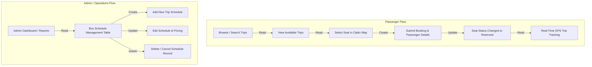

# 4. Flow of Application — EasyBus Online Bus Reservation System

---

## 4.0 Overview of Application Flow & CRUD Operational Plan

The **EasyBus Online Bus Reservation System** is designed to streamline intercity bus operations in Malaysia for two primary user groups:
1. **Passengers (Public Users):** Search available schedules, reserve seats through an interactive cabin map, book tickets, and track bus progress in real time.
2. **Administrators / Bus Operators:** Manage bus fleets, route schedules, driver assignments, ticket fares, and view analytical reports via an administrative dashboard.

The application is structured into five core functional areas covering **Create, Read, Update, Delete (CRUD)** operations and a comprehensive **Dashboard**.

---

## 4.1 CREATE Operations

Create operations allow users and administrators to register new records, book seats, and add schedules into the system.

### Function 1: Register New Bus Schedule
- **Description:** Enables administrators to create a new bus departure schedule between two terminal stations.
- **Frontend Page / Interface:** Form page in `frontend/add-schedule.html` and modal form in `frontend/schedule-list.html`.
- **Form Fields & Input Controls:**
  - `Bus Number` (Text input, e.g., `VJE 9021` or `ABC1234`)
  - `Route Assignment` (Text input, e.g., `Kuala Lumpur to Penang`)
  - `Driver Name` (Text input, e.g., `Ahmad Albab`)
  - `Available Seats` (Number input, e.g., `40`)
  - `Departure Location` (Text input, e.g., `Terminal Bersepadu Selatan (TBS)`)
  - `Arrival Location` (Text input, e.g., `Penang Sentral`)
  - `Departure Date` (Date picker, e.g., `2026-06-01`)
  - `Departure Time` (Time picker, e.g., `08:00 AM`)
  - `Ticket Price` (Currency input, e.g., `RM 35.00`)
  - `Status` (Dropdown select: `Available`, `Full`, `Cancelled`)
- **UI Screen Reference:**
  > **[Screenshot: Add Schedule Form]**  
  > *Capture `frontend/add-schedule.html` showing the card container with input fields and the "Save Schedule" button.*

---

### Function 2: Book Bus Ticket & Reserve Seat
- **Description:** Allows passengers to choose their preferred seat on an interactive VIP bus cabin map and submit a confirmed booking ticket.
- **Frontend Page / Interface:** Interactive seat selection page in `frontend/seat-selection.html`.
- **Form Fields & Input Controls:**
  - `Seat Selection Pins` (Interactive buttons for seats `1A`, `1B`, `1C`, `2A`, `2B`, `2C`)
  - `Seat Category Display` (`VIP Single` vs `Double Seat`)
  - `Passenger Count & Date` (`1 Pax`, `26 Oct 2026, 10:00 PM`)
  - `Total Price Display` (Dynamic fare tally, e.g., `RM 125.00`)
  - `Confirm Seat Button` (Action button that finalizes the reservation and proceeds to tracking)
- **UI Screen Reference:**
  > **[Screenshot: Seat Selection Interface]**  
  > *Capture `frontend/seat-selection.html` displaying the coach interior with seat `1C` highlighted in glowing amber and the bottom confirmation bar.*

---

### Function 3: Register New Passenger Account
- **Description:** Allows new passengers to create an account for managing tickets and viewing trip history.
- **Frontend Page / Interface:** Registration modal / panel in `frontend/index.html`.
- **Form Fields & Input Controls:**
  - `Full Name` (Text input, e.g., `Ali bin Abu`)
  - `Email Address` (Email input, e.g., `ali@example.com`)
  - `Phone Number` (Tel input, e.g., `011-12345678`)
  - `Password` (Password input)
  - `Create Account Button`
- **UI Screen Reference:**
  > **[Screenshot: Passenger Registration Form]**  
  > *Capture the user sign-up form modal on `frontend/index.html`.*

---

### Function 4: Onboard New Bus Vehicle & Assign Driver
- **Description:** Allows fleet managers to register newly acquired buses and add licensed drivers into the system.
- **Frontend Page / Interface:** Admin Fleet Registration Panel.
- **Form Fields & Input Controls:**
  - `Bus Registration Number` (Text input, e.g., `DEF9012`)
  - `Total Seat Capacity` (Number input, e.g., `40`)
  - `Driver Name` (Text input, e.g., `Lim`)
  - `Driver License Number` (Text input, e.g., `LIC-1003`)
  - `Driver Contact Number` (Tel input, e.g., `016-2233445`)
- **UI Screen Reference:**
  > **[Screenshot: Fleet & Driver Registration Form]**  
  > *Capture the vehicle onboarding form interface.*

---

## 4.2 READ (Retrieve) Operations

Read operations display records in structured tables, cards, interactive visual maps, and search views.

### Function 1: Display Master Bus Schedule Table with Live Search Filter
- **Description:** Displays all active bus schedules in a structured data table with real-time keyword search.
- **Frontend Page / Interface:** Data table in `frontend/schedule-list.html`.
- **UI Elements & Table Columns:**
  - `Search Box`: Dynamic filter input by bus number or route.
  - `Bus Number Column`: Shows plate numbers (`ABC1234`, `XYZ5678`, `DEF9012`).
  - `Route Column`: Shows departure and arrival cities (`Kuala Lumpur → Johor Bahru`).
  - `Date & Time Column`: Shows journey date (`2026-06-01`) and departure time (`08:00 AM`).
  - `Price Column`: Highlighted fare tag (`RM35.00`, `RM18.00`, `RM45.00`).
  - `Status Badge`: Color-coded pill (`Available` in green, `Full` in amber, `Cancelled` in gray).
  - `Action Column`: "Edit" and "Delete" buttons for each row.
- **UI Screen Reference:**
  > **[Screenshot: Bus Schedule Management Table]**  
  > *Capture the schedule list table in `frontend/schedule-list.html` displaying the rows and search bar.*

---

### Function 2: Passenger Trip Search by Route & Date
- **Description:** Allows travelers to find available buses matching their origin, destination, and travel date.
- **Frontend Page / Interface:** Search widget and destination cards in `frontend/index.html`.
- **UI Elements & Form Controls:**
  - `Origin Terminal` (Dropdown/text input, e.g., `TBS Kuala Lumpur`)
  - `Destination Terminal` (Dropdown/text input, e.g., `Larkin Sentral, Johor Bahru`)
  - `Travel Date Picker`
  - `Trip Type Selector` (`One-way` vs `Round-trip`)
  - `Passenger Selector` (`1 Adult`)
  - `Search Buses Button` & `Popular Destination Cards` with direct **"Book Now"** shortcuts
- **UI Screen Reference:**
  > **[Screenshot: Trip Search & Destination Cards]**  
  > *Capture the landing page search bar and destination cards on `frontend/index.html`.*

---

### Function 3: Real-Time Seat Availability & Cabin Matrix Display
- **Description:** Displays an interactive cabin layout showing which seats are available, currently chosen, or already occupied.
- **Frontend Page / Interface:** Interactive seat picker in `frontend/seat-selection.html`.
- **UI Elements & Visual States:**
  - `Available Seats`: Translucent white circle markers with hover zoom effect.
  - `Selected Seat`: Glowing amber marker with pulse animation and "Selected" tooltip.
  - `Reserved / Occupied Seats`: Dimmed circle markers with lock key icons (`ph-lock-key`).
  - `Trip Information Card`: Header banner showing route, date, time, and passenger count.
- **UI Screen Reference:**
  > **[Screenshot: Interactive Seat Matrix]**  
  > *Capture `frontend/seat-selection.html` showing available vs locked seats in the coach.*

---

### Function 4: Real-Time Bus Live GPS Tracking & Route Milestones
- **Description:** Displays the current GPS location of an en-route bus along with an itinerary checklist.
- **Frontend Page / Interface:** Dual-pane tracking interface in `frontend/tracking.html`.
- **UI Elements & Visual Components:**
  - `Interactive Leaflet GPS Map`: Real-time map centered on highway coordinates with an animated pulsing bus pin.
  - `Itinerary Progress Timeline`:
    - Step 1: *Ticket Booked* (Completed)
    - Step 2: *Departed KL (TBS)* (Completed)
    - Step 3: *In Transit* (Active marker with ping animation)
    - Step 4: *Approaching Drop-off* (Pending — Skudai Toll Plaza)
    - Step 5: *Arrived at Larkin Sentral* (Pending)
  - `Trip Telemetry Card`: Displays current speed (`82 km/h`), ETA (`1 hr 45 min`), and distance (`135 km`).
- **UI Screen Reference:**
  > **[Screenshot: Live GPS Tracking & Timeline]**  
  > *Capture `frontend/tracking.html` showing the route timeline and interactive map.*

---

## 4.3 UPDATE Operations

Update operations modify existing schedules, seat statuses, and account preferences.

### Function 1: Update Bus Schedule Details
- **Description:** Allows administrators to modify trip times, assigned routes, ticket prices, and schedule availability.
- **Frontend Page / Interface:** Dedicated page in `frontend/edit-schedule.html` or edit modal in `frontend/schedule-list.html`.
- **Editable Form Fields:**
  - `Bus Number` (Pre-filled, e.g., `ABC1234`)
  - `Route Assignment` (Dropdown / Text input, e.g., `Kuala Lumpur → Johor Bahru`)
  - `Departure Date` (Date picker, e.g., `2026-06-01`)
  - `Departure Time` (Time picker, e.g., `08:00 AM`)
  - `Ticket Price` (Currency input, e.g., `RM 35.00`)
  - `Trip Status` (Select options: `Available`, `Full`, `Cancelled`)
  - `Update Schedule Button` & `Cancel / Return Button`
- **UI Screen Reference:**
  > **[Screenshot: Edit Schedule Form]**  
  > *Capture `frontend/edit-schedule.html` or the edit modal dialog with pre-filled inputs.*

---

### Function 2: Update Seat Status Upon Reservation
- **Description:** Transitions a seat's state from `Available` to `Reserved` immediately after booking confirmation.
- **Frontend Page / Interface:** Triggered via the bottom action bar in `frontend/seat-selection.html`.
- **Operational Flow:**
  1. Passenger clicks desired seat (e.g., `1C`).
  2. Bottom panel updates to reflect selected seat and total price (`RM 125`).
  3. Clicking **"Confirm Seat"** locks the seat to prevent other users from selecting it.
- **UI Screen Reference:**
  > **[Screenshot: Seat Selection Confirmation State]**  
  > *Capture the bottom bar of `frontend/seat-selection.html` showing the updated selected seat and "Confirm Seat" button.*

---

### Function 3: Update Booking Status (e.g., Pending to Confirmed / Cancelled)
- **Description:** Updates the payment and operational status of a passenger's booking.
- **Frontend Page / Interface:** Admin Booking Manager panel.
- **Editable Fields:**
  - `Booking Status` (Dropdown options: `Pending`, `Confirmed`, `Completed`, `Cancelled`)
  - `Payment Method / Status` (`Paid Online`, `Cash on Board`)
- **UI Screen Reference:**
  > **[Screenshot: Booking Status Update View]**  
  > *Capture the admin booking status management view.*

---

### Function 4: Update Passenger Profile & Reset Password
- **Description:** Allows registered passengers to update their phone number or reset their login password.
- **Frontend Page / Interface:** Passenger Account Settings Form.
- **Editable Fields:**
  - `Passenger Phone Number` (Text input, e.g., `011-99887766`)
  - `Passenger Email` (Email input)
  - `New Password` & `Confirm New Password`
  - `Save Changes Button`
- **UI Screen Reference:**
  > **[Screenshot: Profile & Password Reset Form]**  
  > *Capture the passenger settings form interface.*

---

## 4.4 DELETE Operations

Delete operations remove obsolete, cancelled, or duplicate records with user confirmation guards.

### Function 1: Delete Bus Schedule Record with Confirmation Alert
- **Description:** Operators can remove a cancelled or obsolete bus trip from the schedule table.
- **Frontend Page / Interface:** Red "Delete" action button in `frontend/schedule-list.html`.
- **Confirmation Flow & Guard:**
  - Clicking the **"Delete"** button triggers a confirmation dialog:
    *"Are you sure you want to delete this bus schedule?"*
  - Upon selecting **OK**, the row is removed with an animation, an alert confirms the deletion (*"Bus schedule has been deleted successfully."*), and the schedule counter updates automatically.
- **UI Screen Reference:**
  > **[Screenshot: Delete Confirmation Dialog]**  
  > *Capture the browser alert popup on `frontend/schedule-list.html` confirming deletion.*

---

### Function 2: Cancel Passenger Booking & Release Reserved Seat
- **Description:** Allows passengers or support staff to cancel an existing booking and return the seat back to available inventory.
- **Frontend Page / Interface:** Passenger "My Bookings" list or Admin Booking Management panel.
- **Operational Flow:**
  1. User selects "Cancel Booking" on an upcoming trip.
  2. System prompts for cancellation confirmation.
  3. Booking record is marked cancelled/removed, and the seat is released back to `Available`.
- **UI Screen Reference:**
  > **[Screenshot: Booking Cancellation Action]**  
  > *Capture the cancellation button and confirmation modal in the booking management view.*

---

### Function 3: Remove Decommissioned Bus or Resigned Driver
- **Description:** Allows administrators to remove decommissioned bus vehicles or inactive driver profiles from the fleet roster.
- **Frontend Page / Interface:** Fleet Management Table in Admin Portal.
- **Operational Controls:**
  - Row-level "Remove Vehicle" / "Remove Driver" action with safety validation check.
- **UI Screen Reference:**
  > **[Screenshot: Fleet Roster Removal]**  
  > *Capture the fleet table showing the remove action icon.*

---

### Function 4: Clear Expired Search & Temporary Booking Sessions
- **Description:** Clears temporary 10-minute seat holds that were abandoned before payment completion.
- **Frontend Page / Interface:** Automated session purge in the booking engine.
- **Operational Flow:**
  - Seat holds older than 10 minutes are automatically cleared so other travelers can reserve them.

---

## 4.5 DASHBOARD & Data Presentation

The Dashboard provides visual data overviews, key metrics, charts, and live operational tracking.

### Feature 1: Operations Overview KPI Metric Cards
- **Description:** Displays quick numerical summary tiles showing fleet and schedule performance.
- **Frontend Page / Interface:** "View Reports" modal in `frontend/schedule-list.html`.
- **KPI Metrics Displayed:**
  - **Total Buses:** `3` Active vehicles in the fleet.
  - **Available Schedules:** `1` Active bookable trip.
  - **Booked / Other:** `2` Trips full or departed.
- **UI Screen Reference:**
  > **[Screenshot: Schedule Reports Overview Modal]**  
  > *Capture the modal that opens upon clicking "View Reports" on `frontend/schedule-list.html` displaying the three metric cards.*

---

### Feature 2: Daily Bookings & Revenue Summary
- **Description:** Summarizes daily ticket sales volume, passenger counts, and cumulative ticket revenue.
- **Frontend Page / Interface:** Daily Financial Summary Dashboard (`frontend/financial-dashboard.html`) and quick KPI banner in `frontend/booking-management.html`.
- **Metrics Displayed:**
  - `Today's Bookings`: Count of completed bookings / tickets sold today (`142 Tickets`).
  - `Total Revenue`: Formatted currency display in Malaysian Ringgit (`RM 4,970.00`).
  - `Average Ticket Value`: Formatted calculation (`RM 35.00` per passenger).
- **UI Screen Reference:**
  > **[Screenshot: Daily Revenue & Ticket Sales Dashboard]**  
  > *Capture the daily financial metric cards and route revenue distribution from `frontend/financial-dashboard.html`.*

---

### Feature 3: Real-Time Fleet Live Tracking Dashboard
- **Description:** Full visual dashboard showing en-route buses across Malaysia's expressway network with active telematics.
- **Frontend Page / Interface:** Dashboard view in `frontend/tracking.html`.
- **Dashboard Components:**
  - **Live GPS Map:** Centered on PLUS Highway with dynamic route polyline from Kuala Lumpur (TBS) to Johor Bahru (Larkin Sentral).
  - **Trip Status Indicator:** Green badge `On Time`.
  - **Telematics Metrics:** Speed (`82 km/h`), Estimated Time of Arrival (`01:15 PM`), Distance Remaining (`135 km`).
  - **Driver Profile Card:** Driver name (`Ahmad Albab`), assigned vehicle (`ABC1234`), and quick contact options.
- **UI Screen Reference:**
  > **[Screenshot: Live GPS Tracking Dashboard]**  
  > *Capture the complete `frontend/tracking.html` interface.*

---

### Feature 4: Seat Occupancy & Route Popularity Charts
- **Description:** Visual representation of route demand and bus cabin load factors.
- **Frontend Page / Interface:** Admin Analytics & Reports view.
- **Visual Presentation:**
  - **Bar / Pie Chart:** Distribution of bookings across top routes:
    - *Kuala Lumpur (TBS) → Johor Bahru (Larkin Sentral):* 48%
    - *Kuala Lumpur (TBS) → Penang Sentral:* 32%
    - *Melaka → Johor Bahru:* 20%
  - **Occupancy Rate Indicator:** Average 82% load factor per departure.
- **UI Screen Reference:**
  > **[Screenshot: Route Analytics Chart]**  
  > *Capture the bar/pie chart representing popular routes.*

---

## 4.6 Quick Summary Matrix of CRUD & Dashboard

| CRUD Category | Function / Feature Name | Relevant Screen / HTML File | Key Form / Table Components |
|---|---|---|---|
| **CREATE** | 1. Register New Bus Schedule | `add-schedule.html` / `schedule-list.html` | Schedule form (Bus No, Route, Time, Price) |
| **CREATE** | 2. Book Ticket & Seat Reservation | `seat-selection.html` | Interactive seat pins (`1C`), Price tally, "Confirm Seat" button |
| **CREATE** | 3. Register New Passenger Account | `index.html` (Modal) | User sign-up form (Name, Email, Phone, Password) |
| **CREATE** | 4. Add Bus Vehicle & Driver | Admin Fleet Panel | Vehicle plate & driver license registration inputs |
| **READ** | 1. Master Schedule Table with Search | `schedule-list.html` | Filterable table showing `ABC1234`, `XYZ5678`, fares, statuses |
| **READ** | 2. Passenger Trip Search by Route | `index.html` | Origin/Destination selectors, date picker, search button |
| **READ** | 3. Interactive Cabin Seat Matrix | `seat-selection.html` | Visual cabin layout showing Available, Selected, and Locked pins |
| **READ** | 4. Live GPS Tracking & Milestones | `tracking.html` | Milestone checklist (Booked, Departed, In Transit) + GPS map |
| **UPDATE** | 1. Edit Bus Schedule Details | `edit-schedule.html` | Pre-populated form to modify time, fare, and trip status |
| **UPDATE** | 2. Update Seat Status to Reserved | `seat-selection.html` | Instant state change from available to locked upon booking |
| **UPDATE** | 3. Update Booking Payment Status | Admin Booking Manager | Status dropdown (`Pending`, `Confirmed`, `Cancelled`) |
| **UPDATE** | 4. Update Passenger Profile / Password | Profile Settings | Contact update and password reset form fields |
| **DELETE** | 1. Delete Bus Schedule Record | `schedule-list.html` | Action button with JavaScript confirmation dialog box |
| **DELETE** | 2. Cancel Booking & Release Seat | Booking Management | Cancel reservation button with automatic seat release |
| **DELETE** | 3. Remove Decommissioned Bus/Driver | Fleet Management | Row-level deletion control for retired assets |
| **DELETE** | 4. Purge Expired Booking Sessions | Booking Engine | Automatic cleanup of abandoned 10-minute seat holds |
| **DASHBOARD** | 1. Operations Overview KPI Tiles | `schedule-list.html` (View Reports) | Modal showing Total Buses (3), Available (1), Booked/Other (2) |
| **DASHBOARD** | 2. Daily Bookings & Revenue Summary | `financial-dashboard.html` | Total tickets sold today (142), Total Revenue (RM 4,970.00), ATV (RM 35.00) |
| **DASHBOARD** | 3. Live GPS Fleet Tracking Board | `tracking.html` | Real-time map, speed (82 km/h), ETA (01:15 PM), Distance (135 km), Driver Ahmad Albab (ABC1234) |
| **DASHBOARD** | 4. Route Popularity & Occupancy Chart | Reports Dashboard | Visual charts showing route volume and cabin occupancy % |

---

## 4.7 Guide to Capturing Screenshots for Your Submission

To insert the actual screenshots into your report or presentation slides:

1. **Schedule Management Table (READ & DELETE):**
   - Open `frontend/schedule-list.html` in your browser.
   - Capture the main table showing the rows for `ABC1234`, `XYZ5678`, `DEF9012` and the top search bar.
   - Click the red **"Delete"** button on any row to screenshot the confirmation alert box: *"Are you sure you want to delete this bus schedule?"*.

2. **Add New Schedule Form (CREATE):**
   - Open `frontend/add-schedule.html` in your browser.
   - Capture the full form showing Bus Number, Route Assignment, Driver Name, Departure Date, Time, and Price.

3. **Edit Schedule Form (UPDATE):**
   - Open `frontend/edit-schedule.html` in your browser (or click **"Edit"** on any row in `schedule-list.html`).
   - Capture the pre-filled form with the update action button.

4. **VIP Seat Selection Map (CREATE & READ):**
   - Open `frontend/seat-selection.html` in your browser.
   - Click seat `1C` to highlight the glowing amber ring, the price calculation (`RM 125`), and the "Confirm Seat" button.

5. **Live GPS Tracking & Route Milestones (READ & DASHBOARD):**
   - Open `frontend/tracking.html` in your browser.
   - Capture the side-by-side view showing the step-by-step trip timeline on the left and the interactive Leaflet map on the right.

6. **Dashboard KPI Reports Modal (DASHBOARD):**
   - Open `frontend/schedule-list.html` and click the **"View Reports"** button in the top right.
   - Capture the popup modal showing **Total Buses (3)**, **Available (1)**, and **Booked/Other (2)**.
